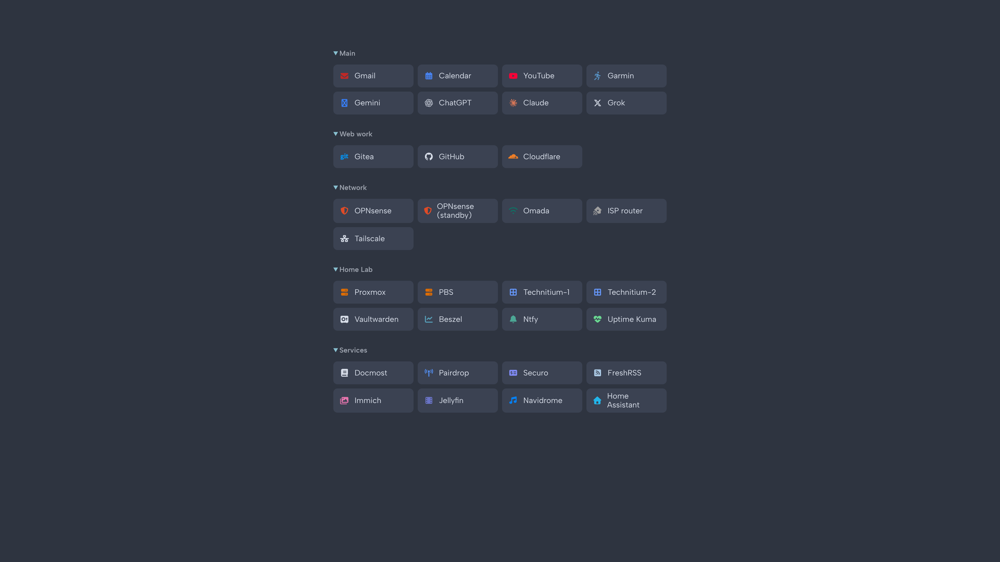
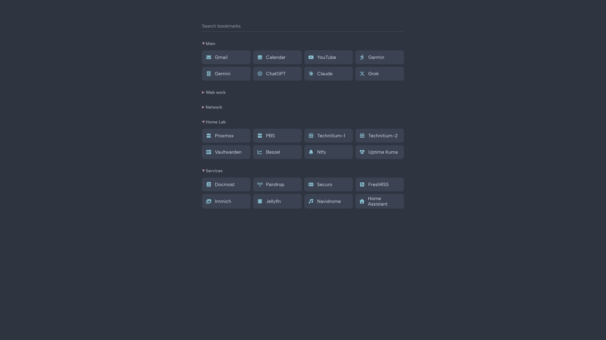
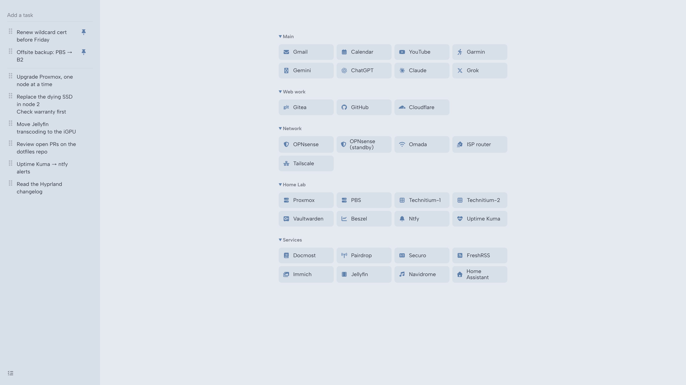
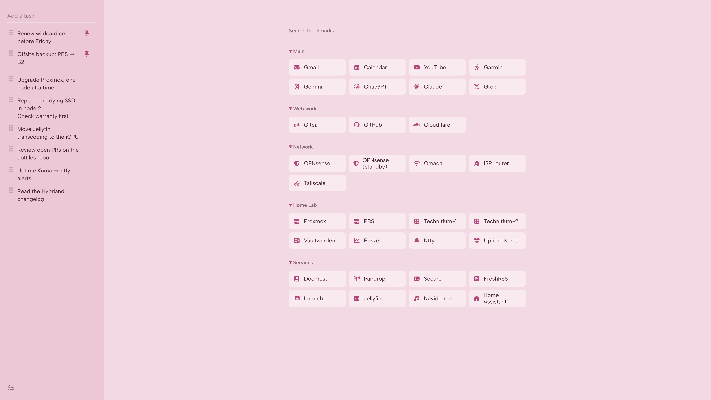

# startpage

A minimal [Nord](https://www.nordtheme.com) start page for the browser: bookmarks, search and a tasks panel.
Plain HTML, CSS and JavaScript. No build step, no framework.

## Download

Get a version from the [latest release](https://github.com/archlinux-fan/startpage/releases/latest), unzip it and open `index.html`.
Each screenshot shows a version in other colors, all picked on the [color page](https://archlinux-fan.github.io/startpage/docs/).

**[startpage.zip](https://github.com/archlinux-fan/startpage/releases/latest/download/startpage.zip):** bookmarks, no JavaScript. Default Nord colors.



**[startpage-search.zip](https://github.com/archlinux-fan/startpage/releases/latest/download/startpage-search.zip):** bookmarks and search. Purple arrows, one-color icons.



**[startpage-tasks.zip](https://github.com/archlinux-fan/startpage/releases/latest/download/startpage-tasks.zip):** bookmarks and the tasks panel. Light theme with dark blue.



**[startpage-search-tasks.zip](https://github.com/archlinux-fan/startpage/releases/latest/download/startpage-search-tasks.zip):** all of it. Pink.



## Or use the files here

The same four versions are in this repo. Open the one you like and delete the others.

| Page | What it has | Files it needs |
|---|---|---|
| `index.html` | bookmarks, no JavaScript | `style.css` |
| `index_search.html` | bookmarks and search | `style.css`, `sections.js`, `search.js` |
| `index_tasks.html` | bookmarks and the tasks panel | `style.css`, `tasks.css`, `sections.js`, `tasks.js` |
| `index_search_tasks.html` | all of it | `style.css`, `tasks.css`, `sections.js`, `search.js`, `tasks.js` |

Every page also uses `favicon.svg`. Try them live:
[index](https://archlinux-fan.github.io/startpage/),
[index_search](https://archlinux-fan.github.io/startpage/index_search.html),
[index_tasks](https://archlinux-fan.github.io/startpage/index_tasks.html),
[index_search_tasks](https://archlinux-fan.github.io/startpage/index_search_tasks.html).

Or [build your own colors](https://archlinux-fan.github.io/startpage/docs/) on a live preview.

## Features

- **Bookmarks** in collapsible sections. In `index.html`, `open` on a section decides if it starts open; the versions with JavaScript remember what you open and close.
- **Search:** start typing anywhere to filter bookmarks, Enter opens the first match, Esc clears. Without JavaScript, Ctrl+F does the job.
- **Tasks panel:** add with Enter, click to edit (Shift+Enter for a new line), pin to the top, drag the grip to reorder, Ctrl+Z to undo. The list icon in the bottom left slides it in and out.
- Works on desktop, tablet and phone.

## Colors

Dark Nord by default. To pick your own, open the [color page](https://archlinux-fan.github.io/startpage/docs/):
choose dark or light, then a color for the background, bookmarks, text, arrows, icons and the tasks panel,
from the 16 Nord colors or any color you like. The preview changes as you click.
Copy the CSS it gives you and paste it at the end of `style.css`, or inside `<style></style>` in the `<head>`
of your page (handy if you keep several pages, each with its own colors).

The color page has to come from a web server (GitHub Pages is one); opened as a local file, its preview doesn't change.

## Edit bookmarks

One link is one line:
```html
<a href="https://example.com"><i class="fa-solid fa-server" style="--c:#dc6c04"></i>Name</a>
```
Icons are from [Font Awesome](https://fontawesome.com/search?ic=free). `--c` is the icon color; leave it out to follow the text color.
Then set your page as the browser's home / new tab page.

## Where your tasks live

Tasks and settings are saved in the browser's `localStorage`, on this device only.
Nothing is synced: another browser, another device or a private window starts empty,
and clearing the browser's site data deletes them.

## Nord colors

[Nord](https://www.nordtheme.com) is an arctic, bluish palette of 16 colors in four groups.

| Group | Color | Hex | On this page |
|---|---|---|---|
| Polar Night (dark) | nord0 | `#2e3440` | dark background, light text |
| | nord1 | `#3b4252` | dark bookmarks and tasks panel |
| | nord2 | `#434c5e` | |
| | nord3 | `#4c566a` | |
| Snow Storm (light) | nord4 | `#d8dee9` | dark text |
| | nord5 | `#e5e9f0` | light background |
| | nord6 | `#eceff4` | |
| Frost (blue) | nord7 | `#8fbcbb` | line under the inputs |
| | nord8 | `#88c0d0` | dark arrows and highlights, line under the inputs |
| | nord9 | `#81a1c1` | line under the inputs |
| | nord10 | `#5e81ac` | light arrows and highlights, line under the inputs |
| Aurora (colors) | nord11 | `#bf616a` | red |
| | nord12 | `#d08770` | orange |
| | nord13 | `#ebcb8b` | yellow |
| | nord14 | `#a3be8c` | green |
| | nord15 | `#b48ead` | purple |

Light bookmarks are `#d7dfe9`, a blue tint between nord5 and nord10. Hover and grey text are mixed from the colors above.

## Image icons

Instead of a Font Awesome icon, a bookmark can show an image. [Dashboard Icons](https://dashboardicons.com/icons)
and [selfh.st icons](https://selfh.st/icons/) have nicely made logos for most self-hosted apps:
```html
<a href="https://proxmox.example.com">Proxmox</a>
<a href="https://immich.example.com">Immich</a>
```
Look up the app on either site and put its name in the link (`proxmox`, `immich`, …).
Image icons keep their own colors, so a one-color icon setting (`--icons`) doesn't change them.
